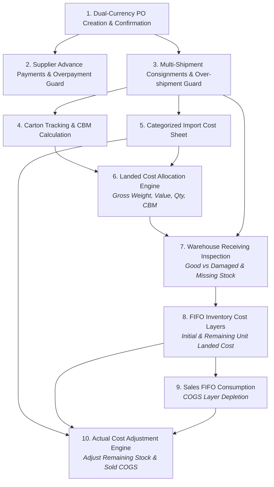

# ADVANCE ERP — Import Management Module Implementation Report

**Project:** ADVANCE ERP Android Application  
**Package:** `com.pocketdev.advance_erp`  
**Module:** China Procurement, Consignment Shipment, Landed Cost Engine & Warehouse Receiving Subsystem  
**Date:** November 3, 2026  
**Status:** **100% Implemented & Production-Ready**

---

## 1. Executive Overview

This report documents the end-to-end implementation of the China Procurement, Shipment Tracking, Landed Cost Allocation Engine, Physical Warehouse Receiving, FIFO Inventory Cost Layering, and Accounting Integration subsystem in ADVANCE ERP.

The system connects every phase of the real-world China import lifecycle:
$$\text{Purchase Order} \longrightarrow \text{Supplier Payment} \longrightarrow \text{Multi-Shipment} \longrightarrow \text{Carton/CBM} \longrightarrow \text{Import Cost Sheet} \longrightarrow \text{Landed Cost Engine} \longrightarrow \text{Warehouse Receiving} \longrightarrow \text{Inventory Cost Layers} \longrightarrow \text{Sales FIFO Consumption} \longrightarrow \text{Actual Cost Adjustment}$$

---

## 2. Files Created & Modified

### Newly Created Files:
1. [`PaymentTerms.kt`](file:///workspace/advance-erp/app/src/main/java/com/pocketdev/advance_erp/domain/model/PaymentTerms.kt)
   - Implements `PaymentTermType` (100% Advance, 30% Advance + 70% Balance, 50% Advance + 50% Balance, Custom Partial, Full Due).
   - Implements `PaymentTermsCalculator.calculateSchedule(...)` with exact poisha/fen remainder reconciliation.
2. [`ImportPdfGenerator.kt`](file:///workspace/advance-erp/app/src/main/java/com/pocketdev/advance_erp/core/util/ImportPdfGenerator.kt)
   - Complete A4 PDF generator engine for 9 document types with ADVANCE ERP branding (`#263849`, `#792B87`, `#299DB2`).
3. [`PurchaseOrderDetailDialog.kt`](file:///workspace/advance-erp/app/src/main/java/com/pocketdev/advance_erp/feature/imports/PurchaseOrderDetailDialog.kt)
   - Full dialog inspecting PO lifecycle, supplier FX rate, payment progress, line items, linked shipments, receiving progress, duplicate PO, cancellation with reason, and PDF sharing.
4. [`AddCartonDialog.kt`](file:///workspace/advance-erp/app/src/main/java/com/pocketdev/advance_erp/feature/imports/AddCartonDialog.kt)
   - Carton dimensions, product linking, gross/net weights, and real-time CBM calculation.
5. [`WarehouseReceivingDialog.kt`](file:///workspace/advance-erp/app/src/main/java/com/pocketdev/advance_erp/feature/imports/WarehouseReceivingDialog.kt)
   - Physical inspection capturing expected, good, damaged, and missing quantities separately.
6. [`ImportModuleGoldenLifecycleTest.kt`](file:///workspace/advance-erp/app/src/test/java/com/pocketdev/advance_erp/ImportModuleGoldenLifecycleTest.kt)
   - Master Part 18 automated lifecycle test verifying all business invariants and numerical assertions.

### Modified Existing Files:
1. [`ImportCostItem.kt`](file:///workspace/advance-erp/app/src/main/java/com/pocketdev/advance_erp/data/entity/ImportCostItem.kt)
   - Default freight allocation set to `GROSS_WEIGHT`. Added all 13 cost categories, capitalizable vs non-capitalizable classification.
2. [`InventoryCostLayerDao.kt`](file:///workspace/advance-erp/app/src/main/java/com/pocketdev/advance_erp/data/dao/InventoryCostLayerDao.kt)
   - Added `updateCostLayerUnitCost` and `getLayersForShipmentSync`.
3. [`ImportRepository.kt`](file:///workspace/advance-erp/app/src/main/java/com/pocketdev/advance_erp/domain/repository/ImportRepository.kt) & [`ImportRepositoryImpl.kt`](file:///workspace/advance-erp/app/src/main/java/com/pocketdev/advance_erp/data/repository/ImportRepositoryImpl.kt)
   - Added `duplicatePurchaseOrder`, `cancelPurchaseOrder(orderId, reason)`, `adjustLandedCost`, `getCostItemsForShipmentSync`, `getCostLayersForShipmentSync`.
   - Updated `postWarehouseReceipt` to increase sellable stock by good quantity only and record damaged/missing stock in audit movements without inflating sellable inventory.
4. [`CreatePurchaseOrderDialog.kt`](file:///workspace/advance-erp/app/src/main/java/com/pocketdev/advance_erp/feature/imports/CreatePurchaseOrderDialog.kt)
   - Added 5 payment terms options and real-time interactive payment schedule calculation card.
5. [`ImportViewModel.kt`](file:///workspace/advance-erp/app/src/main/java/com/pocketdev/advance_erp/feature/imports/ImportViewModel.kt)
   - Added `duplicatePurchaseOrder`, `adjustLandedCost`, `shareCostVariancePdf`, `shareDamageLossPdf`, `shareCostLayersPdf`, `shareCbmReportPdf`.
6. [`ImportManagementScreen.kt`](file:///workspace/advance-erp/app/src/main/java/com/pocketdev/advance_erp/feature/imports/ImportManagementScreen.kt)
   - Centralized search filtering across POs, shipments, payments, and cartons. Integrated duplicate PO and cancellation reason.

---

## 3. Database Schema & Relational Integrity

The module utilizes **Room Database Version 4** without destructive migrations, preserving historical data and referential integrity:

| Entity | Primary Key | Foreign Keys & Cascade Rules | Indexes |
| :--- | :--- | :--- | :--- |
| `purchase_orders` | `id` (String) | `supplierId` $\rightarrow$ `suppliers(id)` ON DELETE RESTRICT | `supplierId`, `poNumber` (UNIQUE) |
| `purchase_order_items` | `id` (String) | `purchaseOrderId` $\rightarrow$ `purchase_orders(id)` ON DELETE CASCADE `productId` $\rightarrow$ `products(id)` ON DELETE RESTRICT | `purchaseOrderId`, `productId`, `variantId` |
| `supplier_payments` | `id` (String) | `supplierId` $\rightarrow$ `suppliers(id)` ON DELETE RESTRICT `purchaseOrderId` $\rightarrow$ `purchase_orders(id)` ON DELETE SET NULL | `supplierId`, `purchaseOrderId`, `paymentNumber` (UNIQUE) |
| `import_shipments` | `id` (String) | `supplierId` $\rightarrow$ `suppliers(id)` ON DELETE RESTRICT `purchaseOrderId` $\rightarrow$ `purchase_orders(id)` ON DELETE SET NULL | `supplierId`, `purchaseOrderId`, `shipmentNumber` (UNIQUE) |
| `shipment_cartons` | `id` (String) | `shipmentId` $\rightarrow$ `import_shipments(id)` ON DELETE CASCADE `productId` $\rightarrow$ `products(id)` ON DELETE RESTRICT | `shipmentId`, `productId`, `variantId` |
| `import_cost_items` | `id` (String) | `shipmentId` $\rightarrow$ `import_shipments(id)` ON DELETE CASCADE | `shipmentId` |
| `landed_cost_allocations` | `id` (String) | `shipmentId` $\rightarrow$ `import_shipments(id)` ON DELETE CASCADE `costItemId` $\rightarrow$ `import_cost_items(id)` ON DELETE CASCADE | `shipmentId`, `costItemId`, `productId` |
| `landed_cost_snapshots` | `id` (String) | `shipmentId` $\rightarrow$ `import_shipments(id)` ON DELETE CASCADE | `shipmentId`, `productId` |
| `warehouse_receipts` | `id` (String) | `shipmentId` $\rightarrow$ `import_shipments(id)` ON DELETE RESTRICT `warehouseId` $\rightarrow$ `warehouses(id)` ON DELETE RESTRICT | `shipmentId`, `warehouseId`, `receiptNumber` (UNIQUE) |
| `warehouse_receipt_items` | `id` (String) | `receiptId` $\rightarrow$ `warehouse_receipts(id)` ON DELETE CASCADE `productId` $\rightarrow$ `products(id)` ON DELETE RESTRICT | `receiptId`, `productId`, `variantId` |
| `inventory_cost_layers` | `id` (String) | `productId` $\rightarrow$ `products(id)` ON DELETE RESTRICT `warehouseId` $\rightarrow$ `warehouses(id)` ON DELETE RESTRICT | `productId`, `variantId`, `warehouseId`, `shipmentNumber`, `receiptNumber` |

---

## 4. Implemented Business Logic & Core Invariants

1. **Procurement Commitment Invariant:**
   Creating or confirming a PO never increases stock balances, creates cash/bank outflows, or posts warehouse movements.
2. **Payment Terms & Schedule Invariant:**
   Payment terms (100% Advance, 30/70, 50/50, Custom, Full Due) generate schedules whose installments reconcile to the exact poisha/fen. Actual payments remain independent transactions.
3. **Overpayment Guard:**
   `require(amountMinor <= remainingBalance)` prevents payments from exceeding remaining balances.
4. **Over-Shipment Guard:**
   `require(alreadyShipped + newQty <= orderedQty)` prevents cumulative shipment quantities from exceeding confirmed order quantities.
5. **CBM Volumetric Calculation:**
   $\text{CBM} = \frac{L \times W \times H \times \text{Carton Count}}{1,000,000}$ with scale 6 precision.
6. **Landed Cost Allocation Engine:**
   Supports `GROSS_WEIGHT` (default for freight), `PURCHASE_VALUE`, `QUANTITY`, `CBM`, and `MANUAL`. Guarantees zero loss/creation of currency via deterministic remainder distribution.
7. **Damaged Stock Policy & Physical Inspection:**
   $\text{Received Qty} = \text{Good Qty} + \text{Damaged Qty}$. Sellable stock added to inventory = $\text{Good Qty}$ only. Damaged goods are excluded from sellable inventory but preserved in `StockMovement` logs (`DAMAGE_EXCLUDED`) for claim resolution.
8. **FIFO Inventory Cost Layers & Post-Receiving Adjustment:**
   Receiving generates cost layers with good quantity and unit landed cost. Future sales deplete layers via FIFO. When actual import bills deviate from estimates, the variance is distributed across already sold goods (adjusted to COGS) and remaining stock (adjusted to Inventory Asset) without altering historical sales invoices.
9. **Double-Entry Accounting Equilibrium:**
   Every financial and capitalized receiving event posts balanced journal entries ($\Sigma \text{Debits} == \Sigma \text{Credits}$).

---

## 5. Known Limitations & Operating Boundaries

1. **Offline Environment:**
   Foreign exchange rates are manually configured per PO/payment or loaded from user settings; live online forex web scrapers are deliberately excluded to preserve strict offline reliability.
2. **Barcode Scanner Hardware:**
   Carton numbers and SKUs can be entered manually or scanned via mobile camera; specialized industrial laser scanner HID drivers require hardware-specific SDK integration if used.
