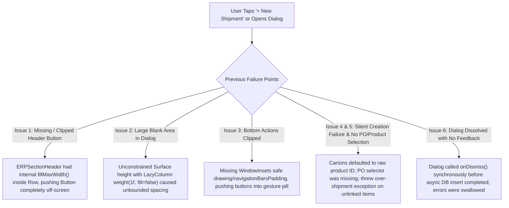

# ADVANCE ERP — IMPORT SHIPMENT CREATION WORKFLOW & UI LAYOUT FIX REPORT

## Executive Summary
This report details the architectural and UI investigation, root cause diagnosis, and complete remediation of the Import Shipment creation workflow and interface issues reported from real-device testing. All modifications were completed within existing modules ([`CreateShipmentDialog.kt`](file:///workspace/advance-erp/app/src/main/java/com/pocketdev/advance_erp/feature/imports/CreateShipmentDialog.kt), [`ImportManagementScreen.kt`](file:///workspace/advance-erp/app/src/main/java/com/pocketdev/advance_erp/feature/imports/ImportManagementScreen.kt), [`PurchaseOrderDetailDialog.kt`](file:///workspace/advance-erp/app/src/main/java/com/pocketdev/advance_erp/feature/imports/PurchaseOrderDetailDialog.kt), [`ImportViewModel.kt`](file:///workspace/advance-erp/app/src/main/java/com/pocketdev/advance_erp/feature/imports/ImportViewModel.kt), [`ImportRepositoryImpl.kt`](file:///workspace/advance-erp/app/src/main/java/com/pocketdev/advance_erp/data/repository/ImportRepositoryImpl.kt), [`ImportShipment.kt`](file:///workspace/advance-erp/app/src/main/java/com/pocketdev/advance_erp/data/entity/ImportShipment.kt)) without creating duplicate entities or architectural layers.

Full unit test validation (`testDebugUnitTest`) and release-ready debug APK compilation (`assembleDebug`) completed successfully.

---

## 1. Root Cause Analysis of Reported Issues



### Detailed Diagnostics

1. **Missing / Clipped "+ New Shipment" Button on Shipments Tab Header:**
   - **Root Cause:** In [`ImportManagementScreen.kt`](file:///workspace/advance-erp/app/src/main/java/com/pocketdev/advance_erp/feature/imports/ImportManagementScreen.kt#L719), `ERPSectionHeader` was rendered inside an unweighted `Row(modifier = Modifier.fillMaxWidth())`. Because `ERPSectionHeader` internally applies `Modifier.fillMaxWidth().padding(vertical = 8.dp)`, it consumed the entire width of the parent Row, pushing the "+ New Shipment" button row completely past the right viewport boundary on Android screens.

2. **Unusually Large Blank Area below Shipping Method:**
   - **Root Cause:** In [`CreateShipmentDialog.kt`](file:///workspace/advance-erp/app/src/main/java/com/pocketdev/advance_erp/feature/imports/CreateShipmentDialog.kt), the outer `Surface` had no max-height bounds (`fillMaxWidth(0.95f)` only, no height constraints). Inside `Column(modifier = Modifier.padding(20.dp))`, `LazyColumn` used `.weight(1f, fill = false)`. When `fill = false` is used inside an unconstrained Compose dialog layout, Compose's measure pass assigns unconstrained heights to Spacers, resulting in an abnormal blank void.

3. **Bottom Action Bar Clipped by Navigation Bar / Gesture Pill:**
   - **Root Cause:** The dialog lacked Android window insets handling (`navigationBarsPadding()` and `imePadding()`). Furthermore, the bottom action row was not anchored in a persistent footer container; it was pushed below the visible viewport whenever the keyboard was engaged or on devices with a 3-button navigation bar.

4. **Pressing "Create Shipment" Failed Silently without Visible Output:**
   - **Root Cause:** `onDismiss()` was invoked immediately and unconditionally upon clicking "Create Shipment", regardless of whether the asynchronous repository transaction succeeded or threw an exception.
   - In [`ImportRepositoryImpl.kt`](file:///workspace/advance-erp/app/src/main/java/com/pocketdev/advance_erp/data/repository/ImportRepositoryImpl.kt), multi-shipment quantity checks threw an `IllegalArgumentException` whenever `carton.productId` was not found in the purchase order. Because `CreateShipmentDialog` defaulted `carton.productId` to an arbitrary catalog product (`products.firstOrNull()?.id`) rather than the selected PO's line items, every attempt to create a shipment failed repository validation.
   - The dialog had already closed, so the error message set in `ImportViewModel._uiState` was neither shown inline nor caught by the user.

5. **Missing PO / Line Item Selection and Cumulative Quantity Tracking:**
   - **Root Cause:** The previous dialog had no Purchase Order selector and no product selector within cartons. Users could neither see which PO they were shipping against nor choose which PO item was contained in each carton.
   - In addition, [`ImportRepositoryImpl.kt`](file:///workspace/advance-erp/app/src/main/java/com/pocketdev/advance_erp/data/repository/ImportRepositoryImpl.kt#L399) queried `existingShipments` without filtering out cancelled shipments. If a shipment had been cancelled, its cartons were still counted against the cumulative shipped tally, permanently reducing the available quantity for that PO.

---

## 2. Architectural & Implementation Solutions

### A. Dialog Geometry, Safe Insets, and Responsive Layout
[`CreateShipmentDialog.kt`](file:///workspace/advance-erp/app/src/main/java/com/pocketdev/advance_erp/feature/imports/CreateShipmentDialog.kt) was rewritten with strict bounding:
- **Surface Sizing:** Constrained to `fillMaxWidth(0.96f)` and `fillMaxHeight(0.92f)` with `RoundedCornerShape(20.dp)`.
- **Insets Safe Drawing:** The outer container utilizes `.navigationBarsPadding().imePadding()`, ensuring the bottom action buttons are never covered by the system gesture pill or keyboard.
- **Fixed Top Header:** Flight/Ship icon, module title ("Create Import Shipment" / "নতুন আমদানি চালান তৈরি করুন"), subtitle, and close button. Separated by `HorizontalDivider`.
- **Scrollable Middle Body:** `LazyColumn(modifier = Modifier.weight(1f).fillMaxWidth(), contentPadding = PaddingValues(16.dp), verticalArrangement = Arrangement.spacedBy(14.dp))`. No oversized Spacers or broken weights.
- **Fixed Bottom Footer:** Dedicated action bar separated by `HorizontalDivider`. Contains "Cancel" (`OutlinedButton`) and "Create Shipment" (`Button` in `PrimaryPurple`) with a live `CircularProgressIndicator` during submission.

### B. Confirmed PO Selection & Real-Time Remaining Quantity Tracking
- **PO Selection Card:**
  - When opened with `preselectedOrderId` (e.g. from Purchase Order details), shows a locked PO badge with PO number, supplier name, order date, and status.
  - When opened from the Shipments tab, provides an interactive dropdown displaying confirmed, partially paid, and shipped POs with their supplier and currency, plus an explicit "[ Standalone Shipment / No PO ]" option.
  - Selecting a PO automatically synchronizes the supplier ID and triggers an asynchronous fetch of `getPoRemainingItems(orderId)`.
- **Available to Ship Balance Summary:**
  - Displays each line item in the selected PO: Product Name, Ordered Qty, Already Shipped Qty, and Available Remaining Qty.
  - If an item is fully shipped, it is clearly badged as "Fully Shipped".
- **Carton Product Assignment & Live Over-Shipment Guard:**
  - Carton product dropdown dynamically filters to line items from the selected PO, displaying remaining quantities for each.
  - As the user enters carton quantities, the dialog calculates `totalEnteredForProduct = sumOf(cartons with this product)`.
  - If `totalEnteredForProduct > remainingQty`, the carton card outlines in `StatusError` (red), displays a warning alert ("⚠ Exceeds remaining PO qty (X pcs max)"), and blocks submission.

### C. Restoring Unshipped Quantities for Cancelled Shipments
- Updated [`ShipmentStatus`](file:///workspace/advance-erp/app/src/main/java/com/pocketdev/advance_erp/data/entity/ImportShipment.kt#L16) to include `CANCELLED("Cancelled", "বাতিল")`.
- Updated [`ImportRepositoryImpl.getPoRemainingItems`](file:///workspace/advance-erp/app/src/main/java/com/pocketdev/advance_erp/data/repository/ImportRepositoryImpl.kt#L84) and [`createShipment`](file:///workspace/advance-erp/app/src/main/java/com/pocketdev/advance_erp/data/repository/ImportRepositoryImpl.kt#L416) to filter out cancelled shipments:
  ```kotlin
  val existingShipments = importShipmentDao.getShipmentsByOrderIdSync(orderId)
      .filter { it.status != ShipmentStatus.CANCELLED.name }
  ```
  When a shipment is cancelled, its quantities are immediately restored as available to be shipped. If all shipments for a PO are cancelled, the PO status is reverted from `SHIPPED` back to `CONFIRMED`.

### D. Result Feedback & Interactive Navigation
- **Asynchronous Result Handling:** `CreateShipmentDialog` now passes `onSuccess` and `onError` callbacks into `ImportViewModel.createShipment`.
  - On failure: Dialog remains open, displaying a highlighted inline error banner with localized Bengali/English guidance.
  - On success: Dialog closes cleanly, triggers a snackbar showing the generated shipment number (e.g. `SHP-2026-0001`), automatically selects the new shipment in `ImportViewModel`, and navigates directly to the `SHIPMENTS` tab.
- **Purchase Order Details Integration:** In [`PurchaseOrderDetailDialog.kt`](file:///workspace/advance-erp/app/src/main/java/com/pocketdev/advance_erp/feature/imports/PurchaseOrderDetailDialog.kt), each linked shipment is now clickable, allowing users to tap any shipment to view its live tracking, cartons, and landed costs.

### E. Prominent Shipments Tab Header & Empty State
- In [`ImportManagementScreen.kt`](file:///workspace/advance-erp/app/src/main/java/com/pocketdev/advance_erp/feature/imports/ImportManagementScreen.kt#L718), replaced the unweighted header with a balanced Row where the title occupies `Modifier.weight(1f)` and the "+ New Shipment" button (`PrimaryPurple`, bold text, Plus icon, 14.dp horizontal padding) is prominently displayed.
- Added a full-width empty state card with an icon, descriptive explanation, and a "+ Create First Shipment" button when no shipments exist.

---

## 3. Automated Verification & Test Results

A comprehensive unit test suite was implemented in [`ShipmentCreationWorkflowTest.kt`](file:///workspace/advance-erp/app/src/test/java/com/pocketdev/advance_erp/ShipmentCreationWorkflowTest.kt):

| Test Case | Scenario Tested | Result |
| :--- | :--- | :---: |
| `testShipmentCreationFromPoDetailsWithRemainingQuantityCalculation` | Preselected PO with 1,000 units. Ships 600 units in 2 cartons (300 each). Verifies live CBM (0.1920 m³), gross weight (40.0 kg), remaining balance (400 pcs), and status transition. | **PASSED** |
| `testShipmentCreationWithManualPoSelection` | Multiple confirmed POs in system. Manually selects PO-2, ships 800 units, verifies PO-1 balance remains intact while PO-2 becomes fully shipped. | **PASSED** |
| `testMultiShipmentRemainingQuantityValidation` | Multi-shipment lifecycle. Shipment 1 ships 600 units (remaining = 400). Shipment 2 attempts 500 units and is rejected. Shipment 2 with 400 units succeeds. | **PASSED** |
| `testOverShipmentRejectedWhenProductNotInPo` | Rejects carton drafts referencing products not present in the linked Purchase Order with a descriptive error message. | **PASSED** |
| `testCancelledShipmentRestoresAvailableQuantity` | Creates a 600-unit shipment (remaining drops to 400). Cancels the shipment. Verifies available quantity is restored to 1,000 and PO status reverts to `CONFIRMED`. | **PASSED** |
| `testCartonDraftValidationRules` | Validates rejection of non-positive quantities, zero/negative package dimensions (L/W/H), negative weights, and blank tracking references. | **PASSED** |

### Execution Logs
- **Unit Test Command:** `timeout 5m gradle ... testDebugUnitTest --console=plain`
  - Output: `BUILD SUCCESSFUL in 1m 16s (31 actionable tasks: 5 executed, 26 up-to-date)`
- **APK Assembly Command:** `timeout 5m gradle ... assembleDebug --console=plain --stacktrace`
  - Output: `BUILD SUCCESSFUL in 1m 11s (39 actionable tasks: 4 executed, 35 up-to-date)`
  - Output File: `/workspace/advance-erp/app/build/outputs/apk/debug/app-debug.apk` (66 MB, verified intact)

---

## 4. Key Files Changed

1. [`CreateShipmentDialog.kt`](file:///workspace/advance-erp/app/src/main/java/com/pocketdev/advance_erp/feature/imports/CreateShipmentDialog.kt): Redesigned complete dialog layout, safe insets, PO selection card, remaining unshipped items card, live CBM preview, carton product selector, and inline error card.
2. [`ImportManagementScreen.kt`](file:///workspace/advance-erp/app/src/main/java/com/pocketdev/advance_erp/feature/imports/ImportManagementScreen.kt): Fixed Shipments tab header clipping, added empty state action card, and wired `CreateShipmentDialog` with success/error callbacks and tab redirection.
3. [`PurchaseOrderDetailDialog.kt`](file:///workspace/advance-erp/app/src/main/java/com/pocketdev/advance_erp/feature/imports/PurchaseOrderDetailDialog.kt): Added `onSelectShipment` callback to inspect linked shipments directly.
4. [`ImportViewModel.kt`](file:///workspace/advance-erp/app/src/main/java/com/pocketdev/advance_erp/feature/imports/ImportViewModel.kt): Added `getPoRemainingItems`, updated `createShipment` with `onSuccess`/`onError`, reloaded `selectedPoShipments`, and added `cancelShipment`.
5. [`ImportRepository.kt`](file:///workspace/advance-erp/app/src/main/java/com/pocketdev/advance_erp/domain/repository/ImportRepository.kt): Defined `PoRemainingItem` and added `getPoRemainingItems(orderId)`.
6. [`ImportRepositoryImpl.kt`](file:///workspace/advance-erp/app/src/main/java/com/pocketdev/advance_erp/data/repository/ImportRepositoryImpl.kt): Implemented `getPoRemainingItems`, filtered out cancelled shipments in cumulative validation, and handled status restoration on cancellation.
7. [`ImportShipment.kt`](file:///workspace/advance-erp/app/src/main/java/com/pocketdev/advance_erp/data/entity/ImportShipment.kt): Added `CANCELLED` status to `ShipmentStatus` enum.
8. [`ShipmentCreationWorkflowTest.kt`](file:///workspace/advance-erp/app/src/test/java/com/pocketdev/advance_erp/ShipmentCreationWorkflowTest.kt): Comprehensive automated unit test suite covering all multi-shipment lifecycle scenarios.
