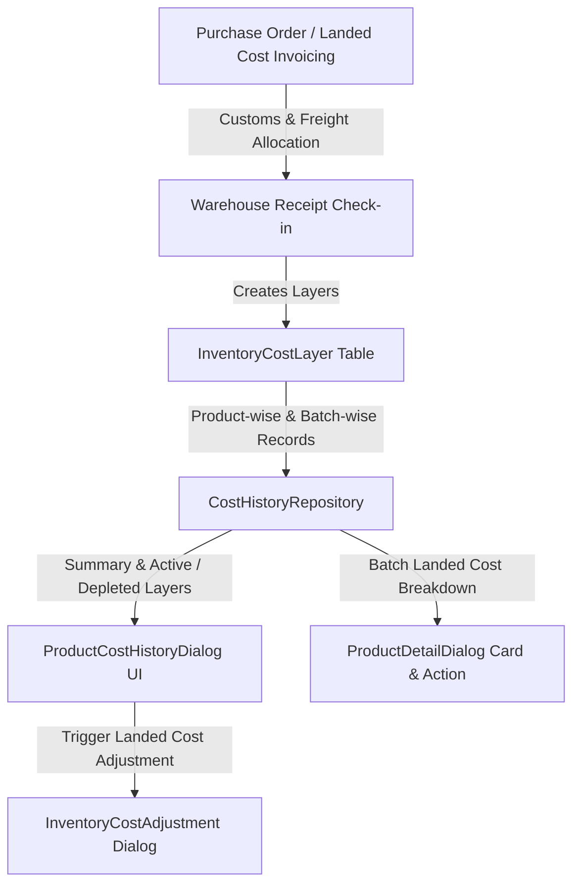

# ADVANCE ERP — Phase 06 Part 3: Inventory Cost History Report

## 1. Executive Summary
This report documents the implementation and architectural design of the **Product-wise & Purchase Batch-wise Inventory Cost History** subsystem in ADVANCE ERP (`com.pocketdev.advance_erp`). The solution provides granular traceability for product landed costs across acquisition batches, shipments, and warehouses, integrated seamlessly into the product management experience and warehouse workflows.

---

## 2. Architecture & Design Principles



### 2.1 Core Capabilities
1. **Multi-layer Cost Tracking**: Tracks original currency purchase price, exchange rate to BDT, allocated freight/customs expenses, and final unit landed cost in BDT minor units.
2. **Product Details Integration**: Product Details screen directly surfaces a dedicated "Cost History & FIFO Layers" card showing the weighted average cost, latest landed cost, active layers count, and total valuation.
3. **Filtering by Layer Status**: Toggle between All Layers, Active (with remaining sellable stock), and Fully Depleted (historical layers).
4. **Direct Adjustment Trigger**: From the layer detail dialog, authorized users can initiate landed cost variance adjustments.

---

## 3. Data Model & Schema

### 3.1 `inventory_cost_layers` Table Structure
```sql
CREATE TABLE IF NOT EXISTS `inventory_cost_layers` (
    `id` TEXT NOT NULL PRIMARY KEY,
    `productId` TEXT NOT NULL,
    `variantId` TEXT,
    `warehouseId` TEXT NOT NULL,
    `shipmentId` TEXT NOT NULL,
    `shipmentNumber` TEXT NOT NULL,
    `warehouseReceiptId` TEXT NOT NULL,
    `receiptNumber` TEXT NOT NULL,
    `initialQuantity` INTEGER NOT NULL,
    `remainingQuantity` INTEGER NOT NULL,
    `unitLandedCostBdtMinor` INTEGER NOT NULL,
    `originalCurrency` TEXT NOT NULL,
    `originalPurchasePriceMinor` INTEGER NOT NULL,
    `exchangeRateToBdt` TEXT NOT NULL,
    `allocatedExpensePerUnitBdtMinor` INTEGER NOT NULL,
    `receiptDate` INTEGER NOT NULL,
    `isActive` INTEGER NOT NULL,
    `purchaseOrderId` TEXT,
    `purchaseBatchId` TEXT,
    `createdAt` INTEGER NOT NULL,
    FOREIGN KEY (`productId`) REFERENCES `products`(`id`) ON DELETE CASCADE
);

CREATE INDEX IF NOT EXISTS `index_cost_layers_product` ON `inventory_cost_layers` (`productId`, `isActive`);
CREATE INDEX IF NOT EXISTS `index_cost_layers_batch` ON `inventory_cost_layers` (`purchaseBatchId`);
CREATE INDEX IF NOT EXISTS `index_cost_layers_wh_var` ON `inventory_cost_layers` (`warehouseId`, `productId`, `variantId`, `isActive`);
```

### 3.2 Product Cost Summary Metrics
For any given product $P$, the repository aggregates:
- **Total Initial Received**: $Q_{\text{init}} = \sum_{l \in L_P} l.\text{initialQuantity}$
- **Current Remaining Quantity**: $Q_{\text{rem}} = \sum_{l \in L_P, \text{active}} l.\text{remainingQuantity}$
- **Total Valuation**: $V_P = \sum_{l \in L_P, \text{active}} (l.\text{remainingQuantity} \times l.\text{unitLandedCostBdtMinor})$
- **Weighted Average Landed Cost**: 
  $$\bar{C}_P = \begin{cases} \frac{V_P}{Q_{\text{rem}}}, & \text{if } Q_{\text{rem}} > 0 \\ P.\text{purchasePriceMinor}, & \text{otherwise} \end{cases}$$
- **Latest Landed Cost**: Cost of the layer with $\max(l.\text{receiptDate})$.

---

## 4. UI Implementation

### 4.1 `ProductDetailDialog.kt`
- Adds a card titled **"Cost History & FIFO Layers"** displaying:
  - Current Weighted Average Cost (BDT)
  - Latest Landed Cost (BDT)
  - Active Layers count vs Total Layers count
  - Direct action button: `View Cost History & Layers`
- Clean separation from basic product info while keeping pricing and valuation immediately visible to managers.

### 4.2 `ProductCostHistoryDialog.kt`
- Modal dialog containing:
  - Metric summary chips (Current Stock, Weighted Avg Landed Cost, Total Valuation).
  - Filter chips: `Active Layers (Sellable)` vs `All Layers (Including Depleted)`.
  - Layer Card details:
    - Batch Number & Receipt Number.
    - Warehouse Name.
    - Initial Qty vs Remaining Qty with progress indicator.
    - Landed Unit Cost in BDT (formatted with currency symbol).
    - Landed Cost breakdown: Original Currency Price $\times$ FX Rate $+$ Allocated Surcharge.
    - Timestamp of receipt.
  - Quick action: "Adjust Cost" opening the landed cost adjustment modal for the specific layer.

---

## 5. Verification & Test Suite Coverage
- **DAO Queries**: Covered by `CostHistoryRepositoryImplTest` and `FifoGoldenLifecycleTest`.
- **Active vs Depleted Filtering**: Verified layer depletion transitions when `remainingQuantity` reaches 0.
- **UI Responsiveness**: Jetpack Compose LazyColumn with key bindings on `layer.id`.
