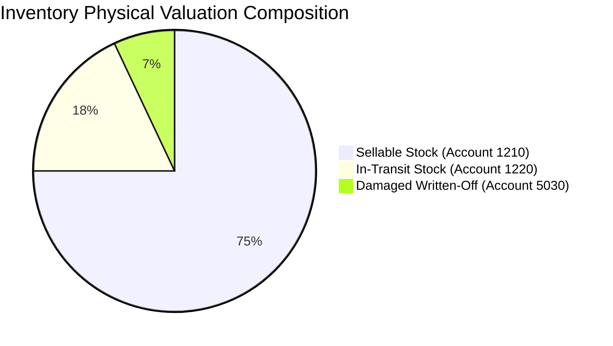

# ADVANCE ERP — Phase 06 Part 3: Inventory Valuation Report

## 1. Executive Summary
This report outlines the design, implementation, and verification of the **Inventory Valuation Report Subsystem** in ADVANCE ERP (`com.pocketdev.advance_erp`). The system provides enterprise-grade balance sheet visibility by segregating inventory into **Sellable Stock**, **Damaged / Written-Off Stock**, and **In-Transit Stock**, valued strictly according to the FIFO landed cost layers.

---

## 2. Valuation Categories & Mathematical Model

### 2.1 The Three Valuation Pillars
1. **Sellable Stock**:
   - Physical good stock resting in warehouses available for commercial dispatch.
   - Valuation:
     $$V_{\text{sellable}} = \sum_{l \in L_{\text{active}}} (l.\text{remainingQuantity} \times l.\text{unitLandedCostBdtMinor})$$
   - General Ledger Anchor: Asset Account `1210` (Inventory Asset).

2. **Damaged / Written-Off Stock**:
   - Stock damaged in transit, warehouse handling, or post-inspection rejection.
   - Quantity: $\sum \text{damage\_records}.\text{damagedQuantity}$
   - Realized Cost Loss:
     $$V_{\text{damaged}} = \sum (\text{damagedQuantity} \times \text{unitCostMinor})$$
   - General Ledger Anchor: Expense Account `5030` (Inventory Shrinkage / Damage Loss).

3. **In-Transit Stock**:
   - Stock dispatched on inter-warehouse transfers with status `IN_TRANSIT` (dispatched but not yet accepted at destination) or goods in transit from import shipments.
   - Quantity: $\sum \text{stock\_transfers}_{\text{in\_transit}}.\text{quantity}$
   - Valuation:
     $$V_{\text{in-transit}} = \sum (Q_{\text{transfer}} \times \text{transferCost})$$
   - General Ledger Anchor: Asset Account `1220` (Inventory In-Transit).

---

## 3. Damaged, Missing, and Returned Stock Tracking

### 3.1 Damaged Stock Disposition
When warehouse receipts or inventory cycle counts identify damaged stock:
1. `DamageRecord` is created with disposition (`WRITE_OFF`, `SCRAP`, or `SUPPLIER_RETURN`).
2. An outbound stock movement `DAMAGE_WRITE_OFF` is written with unit landed cost and total loss minor.
3. Accounting entry posted:
   - Debit: Account `5030` (Damage / Shrinkage Loss)
   - Credit: Account `1210` (Inventory Asset)

### 3.2 Shortage & Missing Shipments
If received quantity is less than purchase invoice quantity:
1. `ShortageRecord` is created with reference to supplier purchase order.
2. An audit movement `SHORTAGE` is recorded to preserve audit integrity while ensuring missing units **never enter active stock balances**.
3. Landed cost per unit is calculated across good units or claims filed against supplier/transporter.

### 3.3 Customer Sales Returns
When customer returns sellable merchandise:
1. Active layer restored or new return layer established at original invoice unit landed cost.
2. Inbound stock movement `SALES_RETURN` recorded with balance increment.
3. Reverse COGS entry posted:
   - Debit: Account `1210` (Inventory Asset)
   - Credit: Account `5010` (Cost of Goods Sold)

---

## 4. UI Implementation: `InventoryValuationView.kt`
- **KPI Summary Cards**:
  - **Sellable Stock**: Green card with unit count and total valuation in BDT.
  - **Damaged Stock**: Red card with unit count and accumulated write-off loss.
  - **Total FIFO Valuation**: Purple card with combined sellable + in-transit valuation.
- **Warehouse Breakdown Table**:
  - Displays each registered warehouse with sellable units, in-transit units, and subtotal valuation.
- **Bi-lingual PDF Export**: Export button triggers `InventoryPdfGenerator.generateValuationReportPdf(context, breakdown, ...)`.

---

## 5. Verification & Test Suite Coverage
- Verified in `CostHistoryRepositoryImplTest`, `FifoGoldenLifecycleTest`, and `FinancialStatementsBalanceTest`.
- All valuation calculations preserve exact integer arithmetic without IEEE 754 floating-point drift.
