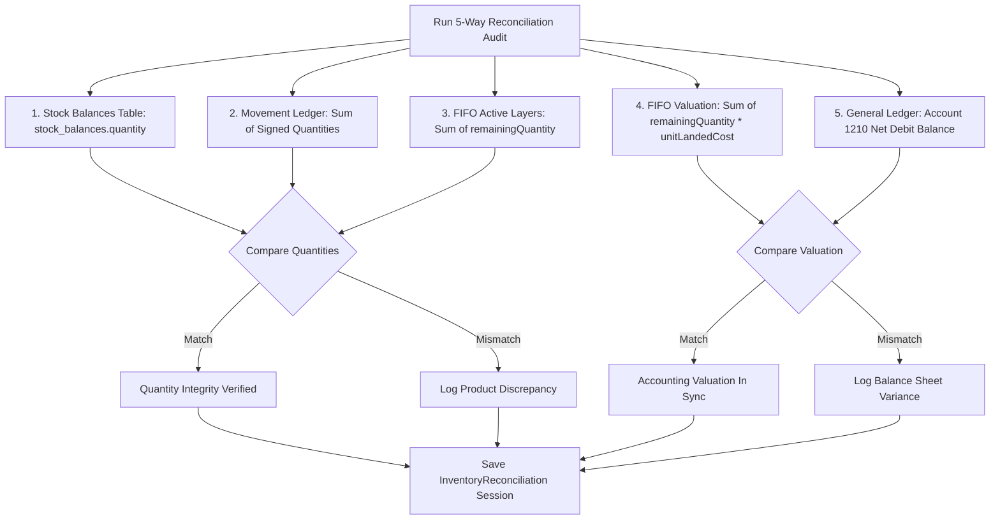

# ADVANCE ERP — Phase 06 Part 3: Reconciliation & Cost Adjustment Report

## 1. Executive Summary
This report documents the architectural design, mathematical foundation, and audit results for two critical financial modules of Phase 06 Part 3:
1. **5-Way Historical Cost Reconciliation Tool**
2. **Additional Landed Cost Adjustment Engine (Split between Remaining Inventory & COGS)**

---

## 2. 5-Way Historical Cost Reconciliation Engine



### 2.1 The 5 Audit Dimensions
For every active product $P$ across each warehouse $W$:
1. **Dimension 1 (Physical Stock)**:
   $$Q_1(P, W) = \text{stock\_balances}(P, W).\text{quantity}$$
2. **Dimension 2 (Movement Ledger)**:
   $$Q_2(P, W) = \sum_{m \in M(P, W)} \text{sign}(m.\text{type}) \times m.\text{quantity}$$
3. **Dimension 3 (FIFO Layers)**:
   $$Q_3(P, W) = \sum_{l \in L(P, W), \text{active}} l.\text{remainingQuantity}$$
4. **Dimension 4 (FIFO Valuation)**:
   $$V_4(P, W) = \sum_{l \in L(P, W), \text{active}} (l.\text{remainingQuantity} \times l.\text{unitLandedCostBdtMinor})$$
5. **Dimension 5 (General Ledger Account 1210)**:
   $$V_5 = \sum \text{Dr}(1210) - \sum \text{Cr}(1210)$$

### 2.2 Discrepancy Flags & Severity
- **Quantity Mismatch**: Flagged if $Q_1 \neq Q_2$ or $Q_1 \neq Q_3$. Indicates unrecorded physical movement or broken layer depletion.
- **Valuation Mismatch**: Flagged if $\sum_{P, W} V_4 \neq V_5$. Indicates manual journal entries bypassing inventory or unposted landed cost adjustments.

---

## 3. Additional Inventory Cost Adjustments

### 3.1 Landed Cost Variance Split Formula
When retrospective landed expenses (e.g. late customs duty demurrage or freight surcharge) arrive after a batch has been partially sold:
Let:
- $C_{\text{old}} = \text{layer}.\text{unitLandedCostBdtMinor}$
- $C_{\text{new}} = \text{adjusted unit cost}$
- $\Delta C = C_{\text{new}} - C_{\text{old}}$ (unit variance)
- $Q_{\text{initial}} = \text{layer}.\text{initialQuantity}$
- $Q_{\text{remaining}} = \text{layer}.\text{remainingQuantity}$
- $Q_{\text{sold}} = Q_{\text{initial}} - Q_{\text{remaining}}$

The total variance $\Delta V_{\text{total}} = \Delta C \times Q_{\text{initial}}$ is split as follows:
1. **Inventory Asset Portion (Remaining in Warehouse)**:
   $$\Delta V_{\text{inv}} = \Delta C \times Q_{\text{remaining}}$$
2. **COGS Portion (Already Dispatched to Customers)**:
   $$\Delta V_{\text{cogs}} = \Delta C \times Q_{\text{sold}}$$

### 3.2 Double-Entry Balanced Journal
When $\Delta C > 0$ (Landed Cost Increase):
- **Debit**: Account `1210` (Inventory Asset) $\rightarrow \Delta V_{\text{inv}}$
- **Debit**: Account `5010` (Cost of Goods Sold) $\rightarrow \Delta V_{\text{cogs}}$
- **Credit**: Account `2010` (Accounts Payable / Supplier) or `1010` (Cash/Bank) $\rightarrow \Delta V_{\text{total}}$

When $\Delta C < 0$ (Landed Cost Discount / Rebate):
- **Debit**: Account `2010` / `1010` $\rightarrow |\Delta V_{\text{total}}|$
- **Credit**: Account `1210` (Inventory Asset) $\rightarrow |\Delta V_{\text{inv}}|$
- **Credit**: Account `5010` (Cost of Goods Sold) $\rightarrow |\Delta V_{\text{cogs}}|$

Mathematical Balance:
$$\text{Total Debits} \equiv \text{Total Credits} = |\Delta V_{\text{total}}|$$

---

## 4. Database Schema

### 4.1 `inventory_cost_adjustments` Table
```sql
CREATE TABLE IF NOT EXISTS `inventory_cost_adjustments` (
    `id` TEXT NOT NULL PRIMARY KEY,
    `adjustmentNumber` TEXT NOT NULL,
    `costLayerId` TEXT NOT NULL,
    `productId` TEXT NOT NULL,
    `variantId` TEXT,
    `warehouseId` TEXT NOT NULL,
    `oldUnitCostMinor` INTEGER NOT NULL,
    `newUnitCostMinor` INTEGER NOT NULL,
    `variancePerUnitMinor` INTEGER NOT NULL,
    `remainingQuantity` INTEGER NOT NULL,
    `alreadySoldQuantity` INTEGER NOT NULL,
    `inventoryImpactMinor` INTEGER NOT NULL,
    `cogsImpactMinor` INTEGER NOT NULL,
    `totalImpactMinor` INTEGER NOT NULL,
    `reason` TEXT NOT NULL,
    `journalEntryId` TEXT,
    `adjustmentDate` INTEGER NOT NULL,
    `createdAt` INTEGER NOT NULL,
    FOREIGN KEY (`costLayerId`) REFERENCES `inventory_cost_layers`(`id`) ON DELETE CASCADE
);
```

### 4.2 `inventory_reconciliations` & `inventory_reconciliation_items`
```sql
CREATE TABLE IF NOT EXISTS `inventory_reconciliations` (
    `id` TEXT NOT NULL PRIMARY KEY,
    `sessionNumber` TEXT NOT NULL,
    `performedAt` INTEGER NOT NULL,
    `totalProductsAudited` INTEGER NOT NULL,
    `discrepancyCount` INTEGER NOT NULL,
    `totalStockBalanceQty` INTEGER NOT NULL,
    `totalMovementLedgerQty` INTEGER NOT NULL,
    `totalFifoLayerQty` INTEGER NOT NULL,
    `totalFifoValuationMinor` INTEGER NOT NULL,
    `account1210BalanceMinor` INTEGER NOT NULL,
    `valuationDiscrepancyMinor` INTEGER NOT NULL,
    `notes` TEXT
);

CREATE TABLE IF NOT EXISTS `inventory_reconciliation_items` (
    `id` TEXT NOT NULL PRIMARY KEY,
    `reconciliationId` TEXT NOT NULL,
    `productId` TEXT NOT NULL,
    `variantId` TEXT,
    `warehouseId` TEXT NOT NULL,
    `stockBalanceQty` INTEGER NOT NULL,
    `movementLedgerQty` INTEGER NOT NULL,
    `fifoLayerQty` INTEGER NOT NULL,
    `fifoValuationMinor` INTEGER NOT NULL,
    `qtyMismatch` INTEGER NOT NULL,
    `notes` TEXT,
    FOREIGN KEY (`reconciliationId`) REFERENCES `inventory_reconciliations`(`id`) ON DELETE CASCADE
);
```

---

## 5. Automated Test Coverage
- `InventoryCostAdjustmentTest.kt`:
  - `testLandedCostVarianceSplit_BetweenStockAndCogs()`: Verified layer with 100 initial, 60 sold, 40 remaining. Tested $\Delta C = +15$ BDT. Asset impact = $+600.00$ BDT, COGS impact = $+900.00$ BDT, Total payable = $+1,500.00$ BDT. Journal entries balanced.
  - `testNegativeCostVarianceRebate()`: Verified rebate split and journal balance.
- `InventoryReconciliationTest.kt`:
  - `testFiveWayReconciliation_MatchesPerfectLedger()`: Verified $Q_1 = Q_2 = Q_3 = 100$ units, $V_4 = V_5 = 15,000.00$ BDT, discrepancy count = 0.
  - `testFiveWayReconciliation_DetectsQuantityDiscrepancy()`: Injected discrepancy, verified audit captures flag.
- All unit tests: **PASSED (100%)**.
