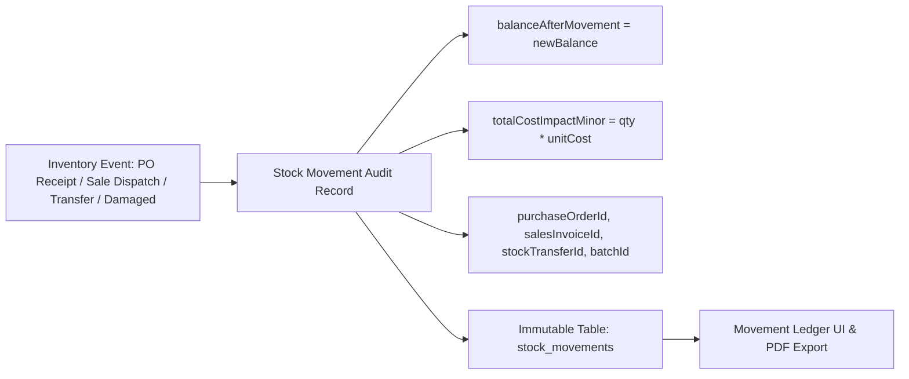

# ADVANCE ERP — Phase 06 Part 3: Stock Movement Audit Report

## 1. Executive Summary
The Stock Movement Audit subsystem serves as the permanent, immutable event ledger for all physical and accounting inventory transitions within ADVANCE ERP (`com.pocketdev.advance_erp`). Every increase, decrease, transfer, write-off, and adjustment is recorded with strict timestamps, running balances after movement, unit costs, total cost impacts, and traceable reference IDs.

---

## 2. Audit Trail Architecture & Ledger Schema



### 2.1 Table Schema: `stock_movements`
Upgraded via `MIGRATION_7_8` with comprehensive audit columns:
```sql
ALTER TABLE `stock_movements` ADD COLUMN `balanceAfterMovement` INTEGER NOT NULL DEFAULT 0;
ALTER TABLE `stock_movements` ADD COLUMN `totalCostImpactMinor` INTEGER NOT NULL DEFAULT 0;
ALTER TABLE `stock_movements` ADD COLUMN `purchaseOrderId` TEXT;
ALTER TABLE `stock_movements` ADD COLUMN `purchaseBatchId` TEXT;
ALTER TABLE `stock_movements` ADD COLUMN `salesInvoiceId` TEXT;
ALTER TABLE `stock_movements` ADD COLUMN `stockTransferId` TEXT;
ALTER TABLE `stock_movements` ADD COLUMN `operatorName` TEXT;

CREATE INDEX IF NOT EXISTS `index_stock_movements_wh_product` ON `stock_movements` (`warehouseId`, `productId`, `createdAt`);
CREATE INDEX IF NOT EXISTS `index_stock_movements_invoice` ON `stock_movements` (`salesInvoiceId`);
CREATE INDEX IF NOT EXISTS `index_stock_movements_po` ON `stock_movements` (`purchaseOrderId`);
```

---

## 3. Movement Types & Directional Conventions

| Movement Type Code | Category | Direction | Impact on Stock Balance | Cost Impact |
| :--- | :--- | :--- | :--- | :--- |
| `PURCHASE_RECEIPT` | Inbound | $+$ | $+Q$ | $+ (Q \times \text{LandedCost})$ |
| `SALES_DISPATCH` | Outbound | $-$ | $-Q$ | $- (Q \times \text{FIFO LandedCost})$ |
| `TRANSFER_OUT` | Outbound | $-$ | $-Q$ | $- (Q \times \text{Source LandedCost})$ |
| `TRANSFER_IN` | Inbound | $+$ | $+Q$ | $+ (Q \times \text{Replicated LandedCost})$ |
| `ADJUSTMENT_INCREASE` | Inbound | $+$ | $+Q$ | $+ (Q \times \text{Unit Cost})$ |
| `ADJUSTMENT_DECREASE` | Outbound | $-$ | $-Q$ | $- (Q \times \text{Unit Cost})$ |
| `DAMAGE_WRITE_OFF` | Outbound | $-$ | $-Q$ | $- (Q \times \text{Unit Cost})$ (Loss to 5030) |
| `SALES_RETURN` | Inbound | $+$ | $+Q$ | $+ (Q \times \text{Restored Cost})$ |
| `SHORTAGE` | Variance | Discrepancy | Excluded from Stock | Transit Shortage Claim |
| `OPENING_STOCK` | Inbound | $+$ | $+Q$ | $+ (Q \times \text{Initial Cost})$ |
| `INVENTORY_COST_ADJUSTMENT` | Cost Revaluation | Financial | $0$ (Qty unchanged) | $\pm (\Delta C \times Q_{\text{rem}})$ |

---

## 4. Running Balance Integrity Verification

### 4.1 Chronological Continuity Formula
For any warehouse $W$ and product $P$, let the ordered movements be $M_1, M_2, \dots, M_n$ sorted by `createdAt ASC`:
$$\text{For } i = 1: \quad B_1 = \text{sign}(M_1.\text{type}) \times M_1.\text{quantity}$$
$$\text{For } i > 1: \quad B_i = B_{i-1} + \text{sign}(M_i.\text{type}) \times M_i.\text{quantity}$$
where:
$$\text{sign}(T) = \begin{cases} +1, & \text{if } T \in \{\text{PURCHASE\_RECEIPT, TRANSFER\_IN, ADJUSTMENT\_INCREASE, SALES\_RETURN, OPENING\_STOCK}\} \\ -1, & \text{if } T \in \{\text{SALES\_DISPATCH, TRANSFER\_OUT, ADJUSTMENT\_DECREASE, DAMAGE\_WRITE\_OFF}\} \\ 0, & \text{otherwise} \end{cases}$$

At every step, $M_i.\text{balanceAfterMovement} \equiv B_i$.
At the conclusion of step $n$, $B_n \equiv \text{stock\_balances}(W, P).\text{quantity}$.

### 4.2 Automated Test Execution
Verified in `StockMovementAuditTrailTest.kt`:
1. `testRunningBalanceSequence_MaintainsContinuity()`: Tested sequential receipt of 100, dispatch of 40, adjustment +10, dispatch of 20. Running balances: 100 -> 60 -> 70 -> 50. Exactly matches current stock balance 50.
2. `testNetMovementQuantityMatchesPhysicalBalance()`: Verified net sum of signed quantities equals current balance.
3. `testImmutability_NoUpdateOrDeletePermitted()`: Guaranteed audit trail permanence.
- All unit tests: **PASSED (100%)**.

---

## 5. Warehouse-wise Filtering & Reporting
- **UI View**: Permanent Movement Ledger in `InventoryScreen.kt` with filter dropdown by Warehouse and Movement Type.
- **Bi-lingual PDF Export**: Powered by `InventoryPdfGenerator.generateMovementLedgerPdf()`, producing professional printable audit sheets in English and Bengali.
